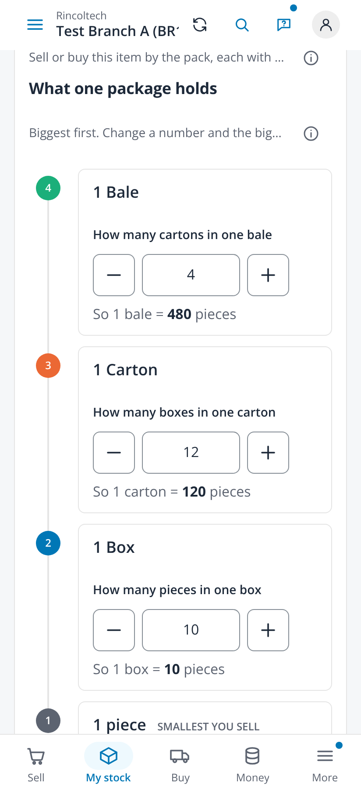
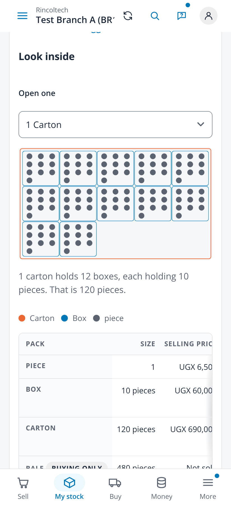
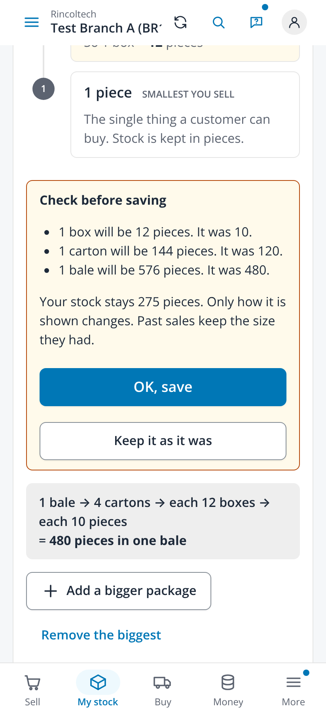
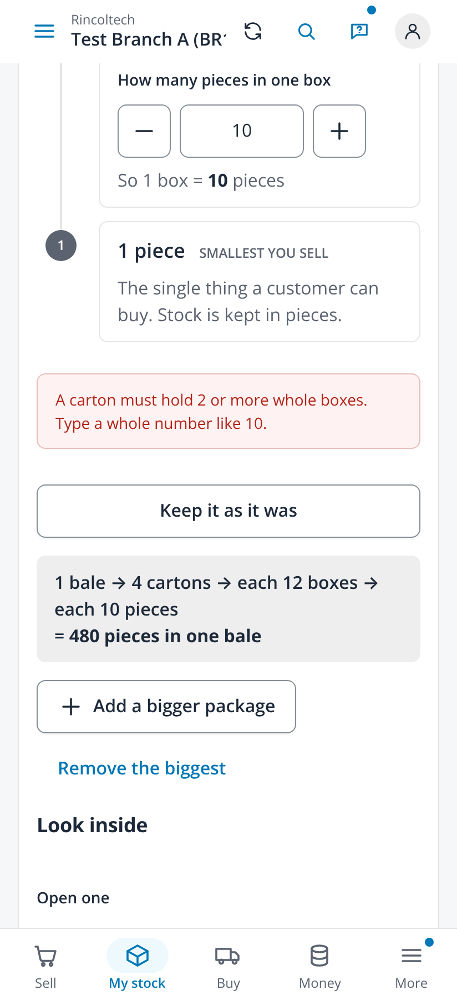
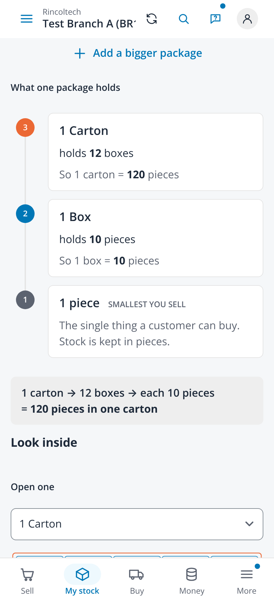
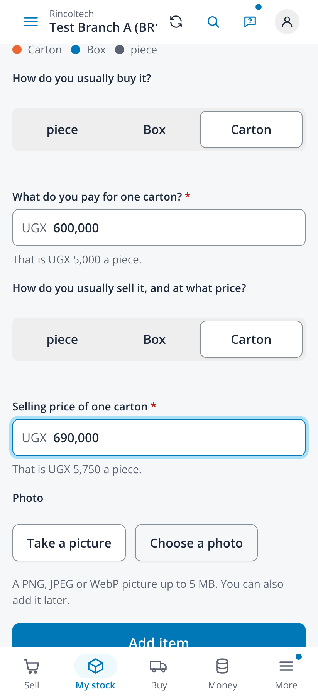
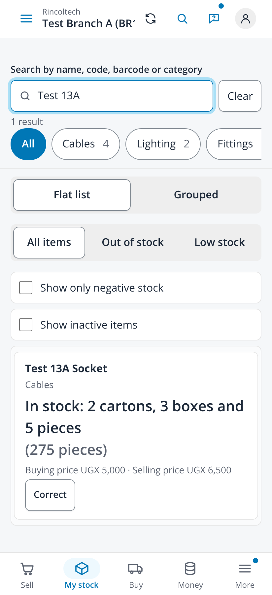
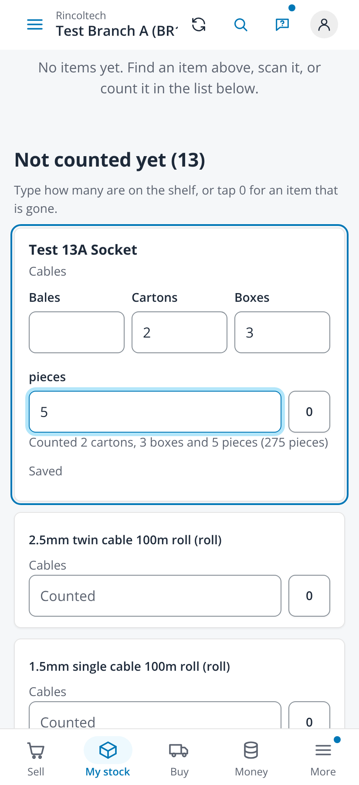
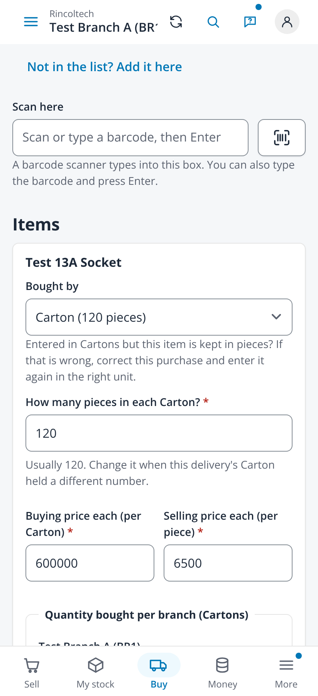
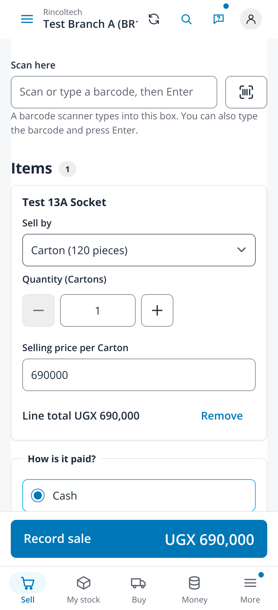

# Packages inside packages, shown as a ladder (issue #699)

Taken on 2026-10-30 from `npm run dev` with `VITE_DEV_TENANT=demo VITE_RETAIL_MOCK=1 VITE_RETAIL_MOCK_CAPS=units` (fabricated
administrator session, no backend) in headless Chromium with reduced motion, at 412x900 (2x, touch) and 1366x900, by
`frontend/scripts/ladder-screenshots.mjs`. The script adds an invented item through the mock's own API in the page: Test 13A
Socket, counted in pieces, a box of 10 pieces (sold at UGX 60,000), a carton of 12 boxes (sold at UGX 690,000, the usual
buying level) and a bale of 4 cartons (buying only), with 275 pieces counted in. No page scrolled sideways at either width.

| File | Screen |
|---|---|
| `01-item-ladder` | The item page: What one package holds, biggest first, a numbered dot per level, a stepper for each number, "So 1 carton = 120 pieces" under each, and the chain "1 bale → 4 cartons → each 12 boxes → each 10 pieces = 480 pieces in one bale" |
| `02-look-inside-carton` | Look inside, one carton opened: 12 boxes drawn, each with its 10 pieces, the same in words and a colour key |
| `03-check-before-saving` | A box made 12 pieces: the box card turns pale, every level above shows its new size, and Check before saving lists "1 box will be 12 pieces. It was 10.", the carton and the bale, says the stock stays 275 pieces, with OK, save and Keep it as it was |
| `04-not-whole-refused` | 2.5 typed for the boxes in a carton: "A carton must hold 2 or more whole boxes. Type a whole number like 10." and nothing is saved |
| `05-add-an-item-ladder` | Add an item: a box of 10 pieces, then Add a bigger package holding the box, "How many boxes in one carton", "So 1 carton = 120 pieces", and the ladder and Look inside under the packages |
| `06-usually-buy-and-sell` | How do you usually buy it? Carton, What do you pay for one carton? 600,000, "That is UGX 5,000 a piece."; How do you usually sell it, and at what price? Carton, 690,000, "That is UGX 5,750 a piece." |
| `07-my-stock-every-level` | My stock: "In stock: 2 cartons, 3 boxes and 5 pieces (275 pieces)" |
| `08-count-every-level` | Count stock: a box for bales, cartons, boxes and pieces; 2, 3 and 5 typed add up to "Counted 2 cartons, 3 boxes and 5 pieces (275 pieces)" |
| `09-buy-stock-usual-carton` | Buy stock opens the line on the carton, the usual buying level, with its 120 pieces |
| `10-sell-a-carton` | Sell by Carton (120 pieces) at its own price, UGX 690,000 |

| Item page | Look inside | Check | Refused | Add an item |
|---|---|---|---|---|
|  |  |  |  |  |

| Usual buy and sell | My stock | Count stock | Buy stock | Sell |
|---|---|---|---|---|
|  |  |  |  |  |

The laptop pictures (`-1366`) show the ladder and Look inside side by side.

One casing everywhere (review of #710): unit words in a sentence are lower case whatever the unit is named, in stock and
count lines ("2 cartons, 3 boxes and 5 pieces") as in the ladder ("So 1 carton = 120 pieces"). The pictures were taken
again after that change and after main's phone search (#690) was merged in.

## Reading it aloud

The issue asks that the words be read aloud to someone who does not read and understood without help. That has not been done
yet: it needs a person in a shop, which a build cannot stand in for. What to read, in order, is the text of pictures 01, 03
and 06: the name of each level, "How many boxes in one carton", "So 1 carton = 120 pieces", the chain under the ladder, the
three lines of Check before saving and "That is UGX 5,000 a piece." Record who heard it and what they had to ask, and add it
here.
